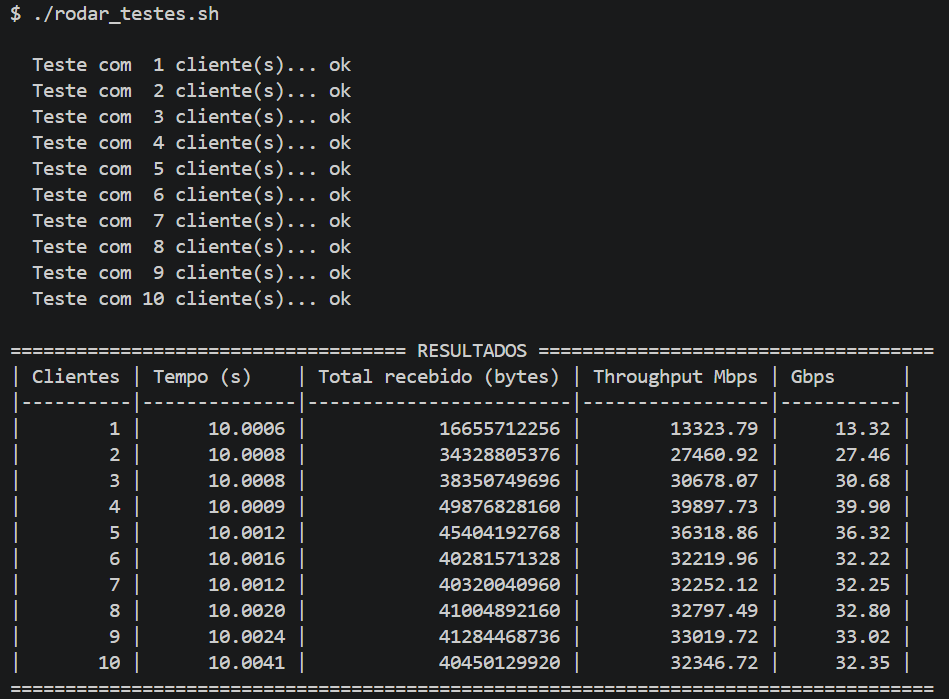

# Projeto: Maximização do Throughput em Rede de Computadores

Projeto da disciplina de **Redes de Computadores (UNIFESP)** para medir o **throughput agregado** de uma rede TCP quando vários clientes transmitem dados simultaneamente para um único servidor.

## Visão geral

O projeto é composto por dois programas em C: um servidor e múltiplos clientes.

- **Servidor (`servidor.c`)**: implementado para Windows, usando **Winsock2** para os sockets e a **API Win32** (`CreateThread`) para threads.
- **Cliente**: existe em duas variantes com a mesma lógica —
  - `cliente.c`: Windows, Winsock2.
  - `cliente_linux.c`: Linux/POSIX, sockets BSD (`sys/socket.h`), usado quando o cliente roda fora do Windows (ver Experimento C).

### Servidor (`servidor.c`)

O servidor:

1. Escuta em uma porta TCP informada pelo usuário;
2. Aguarda a conexão de **todos** os clientes esperados antes de iniciar o teste;
3. Cria uma **thread por cliente** para receber os dados em paralelo;
4. Envia um sinal de início (`'G'`) a todos os clientes e inicia o cronômetro (`QueryPerformanceCounter`);
5. Contabiliza os bytes recebidos de cada cliente até que todos encerrem a conexão;
6. Exibe o total recebido, o tempo medido e o **throughput agregado em Mbps**.

### Cliente (`cliente.c` / `cliente_linux.c`)

O cliente é responsável por estabelecer uma conexão TCP com o servidor e transmitir dados durante um período determinado.

Seu funcionamento ocorre nas seguintes etapas:

1. Recebe como parâmetros o endereço IP do servidor, a porta TCP, a duração do teste e o tamanho dos blocos de dados;
2. Cria um socket TCP (`WSAStartup` + Winsock no Windows; `socket()` POSIX no Linux);
3. Configura o endereço IP e a porta do servidor;
4. Estabelece a conexão TCP com o servidor;
5. Aguarda o recebimento de um byte contendo o caractere `'G'`, enviado pelo servidor como sinal de início do teste;
6. Aloca um buffer de memória com o tamanho de bloco especificado, preenchido com o caractere `'A'`;
7. Inicia a medição do tempo (`QueryPerformanceCounter` no Windows, `clock_gettime(CLOCK_MONOTONIC)` no Linux) e transmite blocos de dados continuamente até atingir a duração configurada;
8. Garante que cada bloco seja enviado completamente, contabilizando a quantidade total de bytes transmitidos;
9. Encerra o envio de dados utilizando `shutdown()` e libera os recursos utilizados.

## Protocolo de comunicação

A comunicação entre cliente e servidor segue o seguinte fluxo:

1. O servidor inicia e aguarda as conexões dos clientes;
2. Cada cliente estabelece uma conexão TCP com o servidor;
3. O servidor aguarda a conexão de todos os clientes esperados;
4. O servidor envia o sinal de início (`'G'`) para cada cliente;
5. Os clientes iniciam a transmissão contínua de dados;
6. Ao atingir a duração configurada, cada cliente encerra seu envio;
7. O servidor identifica o encerramento de cada transmissão e calcula o throughput agregado.

> O servidor considera a transmissão de um cliente finalizada quando `recv()` retorna `0` (conexão encerrada) ou ocorre um erro.

## Compilação

### Servidor e cliente Windows — MinGW (GCC)

```bash
gcc -O3 servidor.c -o servidor.exe -lws2_32
gcc -O3 cliente.c  -o cliente.exe  -lws2_32
```

### Servidor e cliente Windows — MSVC (Developer Command Prompt)

```bash
cl servidor.c
cl cliente.c
```

> No MSVC, a biblioteca `Ws2_32.lib` é vinculada automaticamente via `#pragma comment(lib, "Ws2_32.lib")`.

### Cliente Linux

```bash
gcc -O3 cliente_linux.c -o cliente
```

### Via `Makefile`

```bash
make servidor         # servidor.exe (Windows, MinGW)
make cliente           # cliente.exe (Windows, MinGW)
make cliente-linux     # cliente (Linux)
```

## Execução

### Servidor

```bash
.\servidor.exe <porta> <numero_clientes>
```

| Parâmetro | Descrição | Limites |
|---|---|---|
| `porta` | Porta TCP em que o servidor irá escutar | 1 – 65535 |
| `numero_clientes` | Quantidade de clientes simultâneos esperada | 1 – 10 |

Exemplo:

```bash
.\servidor.exe 5000 4
```

### Cliente

```bash
.\cliente.exe <IP> <porta> <duracao> <bloco_bytes>
```

| Parâmetro | Descrição | Limites |
|---|---|---|
| `IP` | Endereço IPv4 do servidor | Endereço IPv4 válido (ex: `127.0.0.1`) |
| `porta` | Porta TCP utilizada pelo servidor | 1 – 65535 |
| `duracao` | Tempo de transmissão em segundos | Maior ou igual a 1 |
| `bloco_bytes` | Tamanho de cada bloco de dados transmitido, em bytes | 1 – 1.048.576 |

Exemplo:

```bash
.\cliente.exe 127.0.0.1 5000 10 65536
```

Nesse exemplo, o cliente se conecta ao servidor no endereço local `127.0.0.1`, utilizando a porta `5000`, e transmite dados durante 10 segundos, em blocos de 65.536 bytes (64 KiB).

> **Atenção:** O número de clientes iniciados nos terminais deve corresponder exatamente ao número informado na execução do servidor para que o teste seja disparado.

## Cálculo do throughput

O servidor calcula o throughput agregado considerando a quantidade total de bytes recebidos de todos os clientes e o tempo total da medição:

```text
throughput (Mbps) = (total_bytes × 8) / (tempo_em_segundos × 1.000.000)
```

O tempo é medido desde o envio do sinal de início até o término de todas as threads de recepção.

## Configurações

### Servidor (`servidor.c`)

| Constante | Valor | Descrição |
|---|---|---|
| `MAX_CLIENTS` | `10` | Número máximo de clientes simultâneos |
| `BUFFER_SIZE` | `65536` | Tamanho do buffer de recepção (bytes) |

### Cliente (`cliente.c` / `cliente_linux.c`)

| Constante | Valor | Descrição |
|---|---|---|
| `MAX_BUFFER_SIZE` | `1048576` | Tamanho máximo permitido para o buffer de transmissão (1 MiB) |

---

## Ambiente dos experimentos

Foram realizados três experimentos, em três máquinas diferentes: dois de comunicação local (*loopback*) e um de comunicação entre máquinas distintas em rede local.

| Experimento | Tipo de comunicação | Aluno | Endereço usado |
|---|---|---|---|
| **A** | Loopback (servidor e clientes na mesma máquina) | Lucas Molinari | `127.0.0.1` |
| **B** | Loopback (servidor e clientes na mesma máquina) | Arthur Romano | `127.0.0.1` |
| **C** | Rede local Wi-Fi (servidor e clientes em máquinas distintas) | Thomas Pires Correia | IP da máquina servidora |

Parâmetros de teste, comuns aos três experimentos: duração de **10 segundos**, blocos de **65.536 bytes (64 KiB)**, de **1 a 10 clientes simultâneos**, compilação com `-O3`.

### Máquina do Experimento A (Lucas Molinari)

| Componente | Especificação |
|---|---|
| Processador | Intel Core i5-1245U (12ª geração), 10 núcleos (2 P-cores + 8 E-cores), 12 threads, até 4,4 GHz |
| Memória RAM | 32 GB DDR5 (2 × 16 GB @ 4800 MT/s) |
| Sistema operacional | Windows 11 |
| Compilador | GCC 15.2.0 (MSYS2 UCRT64), flag `-O3` |
| Biblioteca de sockets | Winsock |
| Interface de comunicação | Loopback (`127.0.0.1`) |

### Máquina do Experimento B (Arthur Romano)

| Componente | Especificação |
|---|---|
| Processador | 13th Gen Intel(R) Core(TM) i5-1334U (1,30 GHz) |
| Núcleos / Threads | 10 núcleos, 12 threads |
| Memória RAM | 16,0 GB (utilizável: 15,7 GB) |
| Sistema operacional | Windows 11 |
| Compilador | GCC 16.2.0 |
| Biblioteca de sockets | Winsock |
| Interface de comunicação | Loopback (`127.0.0.1`) |

### Máquinas do Experimento C (Thomas Pires Correia)

| Característica | Servidor (máquina 3) | Cliente (máquina 4) |
|---|---|---|
| Processador | Intel Core i7-14700HX | Intel Core i5-1135G7 (11ª geração) @ 2,40GHz |
| Núcleos / Threads | 20 núcleos / 28 threads | 4 núcleos / 8 threads |
| Memória RAM | 15,71 GB | 15 GB |
| Sistema operacional | Windows 11 Home, build 26200 | Ubuntu 24.04.4 LTS |
| Compilador | GCC 16.2.0 | GCC 13.3.0 |
| Biblioteca de sockets | Winsock | BSD Sockets |
| Endereço IP | 192.168.15.6 | 192.168.15.7 |
| Interface de rede | Wi-Fi | Wi-Fi |

| Característica da rede | Configuração |
|---|---|
| Tipo de conexão | Wi-Fi 6 (802.11ax), 5 GHz |
| Velocidade do link | 1081 Mbps (recepção) / 1201 Mbps (transmissão) |
| Faixa de rede | 192.168.15.x (192.168.15.0/24) |
| Porta TCP utilizada | 5000 |

---

## Resultados

### Experimento A — comunicação local (Lucas Molinari)

Reprodução automatizada com o script `rodar_testes.sh` (compila e roda 1 a 10 clientes via Git Bash/MSYS2):

```bash
./rodar_testes.sh              # padrão: 1 a 10 clientes, 10 s, blocos de 65536 bytes
./rodar_testes.sh 10 10 65536  # equivalente, com parâmetros explícitos
```

| Clientes | Tempo (s) | Total recebido (bytes) | Throughput (Mbps) | Throughput (Gbps) |
|:---:|:---:|---:|---:|---:|
| 1  | 10.0006 | 16.655.712.256 | 13.323,79 | ~13,32 |
| 2  | 10.0008 | 34.328.805.376 | 27.460,92 | ~27,46 |
| 3  | 10.0008 | 38.350.749.696 | 30.678,07 | ~30,68 |
| 4  | 10.0009 | 49.876.828.160 | **39.897,73** | ~39,90 |
| 5  | 10.0012 | 45.404.192.768 | 36.318,86 | ~36,32 |
| 6  | 10.0016 | 40.281.571.328 | 32.219,96 | ~32,22 |
| 7  | 10.0012 | 40.320.040.960 | 32.252,12 | ~32,25 |
| 8  | 10.0020 | 41.004.892.160 | 32.797,49 | ~32,80 |
| 9  | 10.0024 | 41.284.468.736 | 33.019,72 | ~33,02 |
| 10 | 10.0041 | 40.450.129.920 | 32.346,72 | ~32,35 |

<details>
<summary>Captura de tela (bateria de 1 a 10 clientes)</summary>


</details>

<details>
<summary>Bytes recebidos por cliente, em cada cenário</summary>

| Clientes | Bytes por cliente |
|---|---|
| 1 | 16.655.712.256 |
| 2 | 17.345.675.264 / 16.983.130.112 |
| 3 | 12.817.530.880 / 12.677.021.696 / 12.856.197.120 |
| 4 | 12.623.020.032 / 12.599.885.824 / 12.027.691.008 / 12.626.231.296 |
| 5 | 9.138.667.520 / 9.023.717.376 / 9.114.746.880 / 9.154.920.448 / 8.972.140.544 |
| 6 | 6.706.233.344 / 6.998.589.440 / 6.619.987.968 / 6.781.665.280 / 6.737.756.160 / 6.437.339.136 |
| 7 | 5.658.836.992 / 5.696.126.976 / 5.814.943.744 / 5.665.980.416 / 5.843.451.904 / 5.904.007.168 / 5.736.693.760 |
| 8 | 5.200.936.960 / 5.029.953.536 / 4.985.716.736 / 5.041.553.408 / 5.113.118.720 / 5.199.233.024 / 5.369.364.480 / 5.065.015.296 |
| 9 | 4.271.833.088 / 4.587.782.144 / 4.737.335.296 / 4.628.938.752 / 4.753.195.008 / 4.468.047.872 / 4.546.822.144 / 4.588.961.792 / 4.701.552.640 |
| 10 | 3.856.007.168 / 4.073.914.368 / 4.058.972.160 / 4.091.150.336 / 4.258.267.136 / 4.379.705.344 / 4.010.082.304 / 3.942.187.008 / 3.867.672.576 / 3.912.171.520 |

</details>

---

### Experimento B — comunicação local (Arthur Romano)

| Clientes | Tempo (s) | Total recebido (bytes) | Throughput (Mbps) | Throughput (Gbps) |
|:---:|:---:|---:|---:|---:|
| 1  | 10.0024 | 25.818.955.776 | 20.650,31 | ~20,65 |
| 2  | 10.0020 | 52.880.736.256 | 42.296,12 | ~42,30 |
| 3  | 10.0024 | 52.320.665.600 | 41.846,54 | ~41,85 |
| 4  | 10.0031 | 71.237.763.072 | 56.972,30 | ~56,97 |
| 5  | 10.0067 | 81.604.706.304 | 65.240,13 | ~65,24 |
| 6  | 10.0094 | 48.338.829.312 | 38.634,90 | ~38,63 |
| 7  | 10.0166 | 80.332.587.008 | 64.159,66 | ~64,16 |
| 8  | 10.0162 | 48.026.091.520 | 38.358,86 | ~38,36 |
| 9  | 10.0140 | 46.911.848.448 | 37.477,16 | ~37,48 |
| 10 | 10.0171 | 90.278.723.584 | **72.099,59** | ~72,10 |

<details>
<summary>Capturas de tela (servidor e cliente, por cenário)</summary>

| Clientes | Servidor | Cliente |
|:---:|---|---|
| 1 |  |  |
| 2 |  |  |
| 3 |  |  |
| 4 |  |  |
| 5 |  |  |
| 6 |  |  |
| 7 |  |  |
| 8 |  |  |
| 9 |  |  |
| 10 |  |  |

</details>

<details>
<summary>Bytes recebidos por cliente, em cada cenário</summary>

| Clientes | Bytes por cliente |
|---|---|
| 1 | 25.818.955.776 |
| 2 | 26.610.434.048 / 26.270.302.208 |
| 3 | 16.883.318.784 / 17.090.347.008 / 18.346.999.808 |
| 4 | 17.415.733.248 / 17.669.488.640 / 17.825.005.568 / 18.327.535.616 |
| 5 | 16.883.974.144 / 16.245.653.504 / 16.251.813.888 / 15.959.523.328 / 16.263.741.440 |
| 6 | 8.018.329.600 / 8.251.310.080 / 7.796.162.560 / 7.987.003.392 / 8.385.265.664 / 7.900.758.016 |
| 7 | 11.157.438.464 / 11.036.262.400 / 11.092.230.144 / 10.934.353.920 / 11.039.670.272 / 11.038.097.408 / 14.034.534.400 |
| 8 | 5.691.277.312 / 5.884.149.760 / 5.630.590.976 / 5.779.095.552 / 5.705.891.840 / 6.301.614.080 / 6.705.577.984 / 6.327.894.016 |
| 9 | 5.095.948.288 / 5.257.101.312 / 4.696.506.368 / 4.807.917.568 / 4.959.633.408 / 4.959.502.336 / 5.635.375.104 / 5.696.061.440 / 5.803.802.624 |
| 10 | 7.885.946.880 / 8.056.078.336 / 7.692.943.360 / 8.288.534.528 / 8.039.432.192 / 7.999.455.232 / 10.776.084.480 / 11.142.627.328 / 10.102.112.256 / 10.295.508.992 |

</details>

---

### Experimento C — comunicação entre máquinas (Thomas Pires Correia)

Servidor (`servidor.exe`) rodando na máquina 3 (Windows); clientes (`cliente`, compilado de `cliente_linux.c`) rodando na máquina 4 (Linux), conectando via IP da rede local (sem loopback).

| Clientes | Tempo (s) | Total recebido (bytes) | Throughput (Mbps) |
|:---:|:---:|---:|---:|
| 1  | 10.0525 | 482.541.568 | 384,02 |
| 2  | 10.1502 | 495.386.624 | 390,44 |
| 3  | 10.1633 | 521.863.168 | 410,78 |
| 4  | 10.2350 | 527.302.656 | 412,16 |
| 5  | 10.2810 | 516.030.464 | 401,54 |
| 6  | 10.2888 | 541.851.648 | 421,31 |
| 7  | 10.3440 | 548.012.032 | 423,83 |
| 8  | 10.3945 | 541.786.112 | 416,98 |
| 9  | 10.4132 | 552.861.696 | **424,74** |
| 10 | 10.4837 | 551.813.120 | 421,08 |

<details>
<summary>Capturas de tela do servidor, por cenário</summary>

.png)
.png)
.png)
.png)
.png)
</details>

<details>
<summary>Gráfico de throughput por número de clientes</summary>


</details>

<details>
<summary>Bytes recebidos por cliente, em cada cenário</summary>

| Clientes | Bytes por cliente |
|---|---|
| 1 | 482.541.568 |
| 2 | 193.200.128 / 302.186.496 |
| 3 | 259.719.168 / 91.619.328 / 170.524.672 |
| 4 | 92.667.904 / 116.981.760 / 100.335.616 / 217.317.376 |
| 5 | 112.001.024 / 105.185.280 / 97.320.960 / 101.974.016 / 99.549.184 |
| 6 | 83.230.720 / 83.034.112 / 136.970.240 / 79.691.776 / 79.495.168 / 79.429.632 |
| 7 | 86.441.984 / 76.611.584 / 58.261.504 / 82.903.040 / 73.007.104 / 86.573.056 / 84.213.760 |
| 8 | 64.946.176 / 47.972.352 / 72.744.960 / 79.429.632 / 72.744.960 / 65.732.608 / 74.055.680 / 64.159.744 |
| 9 | 61.145.088 / 47.710.208 / 67.436.544 / 37.879.808 / 62.062.592 / 76.152.832 / 106.168.320 / 47.644.672 / 46.661.632 |
| 10 | 55.115.776 / 58.589.184 / 41.222.144 / 45.154.304 / 64.094.208 / 67.895.296 / 64.749.568 / 37.158.912 / 66.125.824 / 51.707.904 |

</details>

---

### Comparação entre os experimentos (Mbps)

| Clientes | Experimento A | Experimento B | Experimento C |
|:---:|---:|---:|---:|
| 1  | 13.323,79 | 20.650,31 | 384,02 |
| 2  | 27.460,92 | 42.296,12 | 390,44 |
| 3  | 30.678,07 | 41.846,54 | 410,78 |
| 4  | 39.897,73 | 56.972,30 | 412,16 |
| 5  | 36.318,86 | 65.240,13 | 401,54 |
| 6  | 32.219,96 | 38.634,90 | 421,31 |
| 7  | 32.252,12 | 64.159,66 | 423,83 |
| 8  | 32.797,49 | 38.358,86 | 416,98 |
| 9  | 33.019,72 | 37.477,16 | 424,74 |
| 10 | 32.346,72 | 72.099,59 | 421,08 |

> Observação: cada cenário (combinação de experimento × número de clientes) foi executado uma única vez — não são médias de múltiplas repetições.

---

## Estrutura do repositório

```text
.
├── cliente.c                        # Cliente TCP (Windows, Winsock)
├── cliente_linux.c                  # Cliente TCP (Linux, sockets BSD)
├── servidor.c                       # Servidor TCP multithread (Windows, Winsock)
├── Makefile                         # Compilação (servidor/cliente Windows e Linux)
├── rodar_testes.sh                  # Bateria automatizada de testes 1-10 clientes (loopback)
├── prints/
│   ├── teste_completo_notebook.png  # Experimento A (Lucas Molinari)
│   └── Testes parte 1/              # Experimento B (Arthur Romano)
├── Testes/
│   └── testeC/                      # Experimento C (Thomas Pires Correia)
│       ├── Resultados.md
│       └── Terminal_Servidor(*).png
├── README.md
└── .gitignore