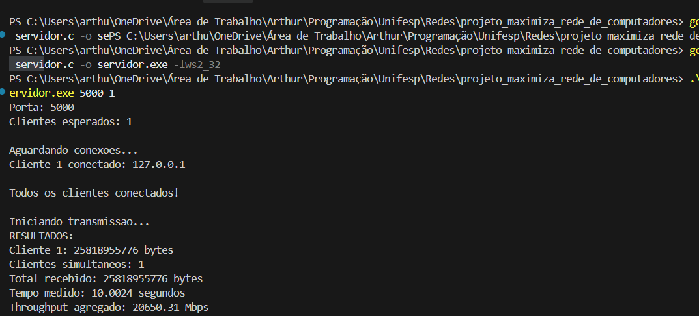
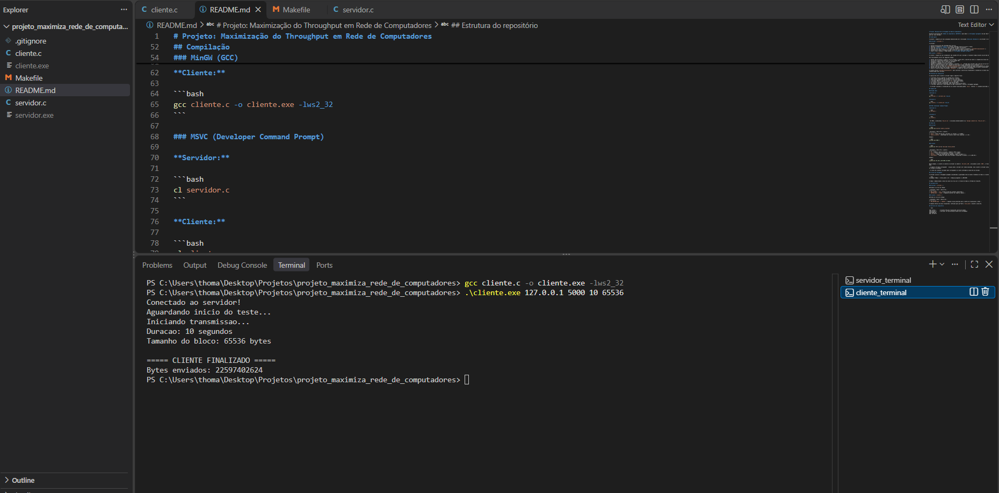
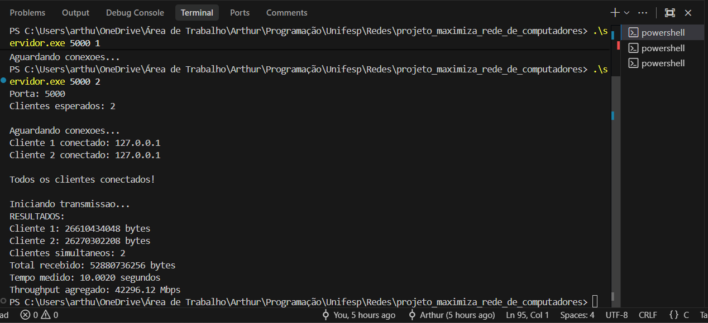
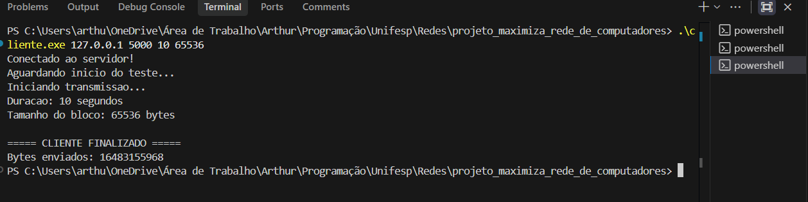
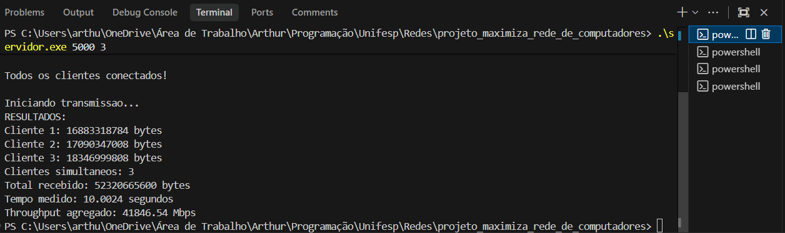
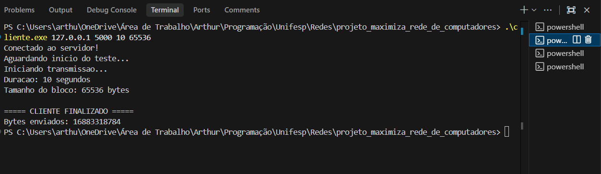
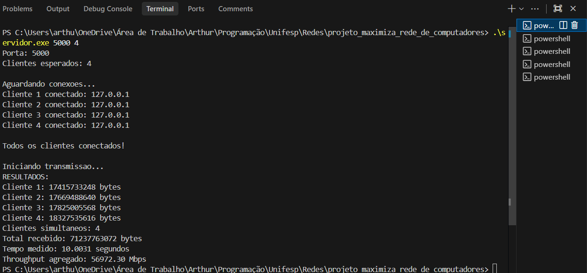
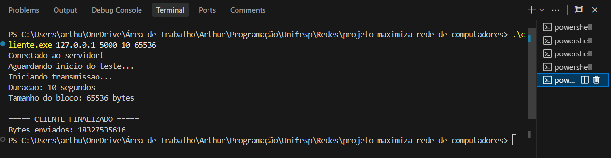
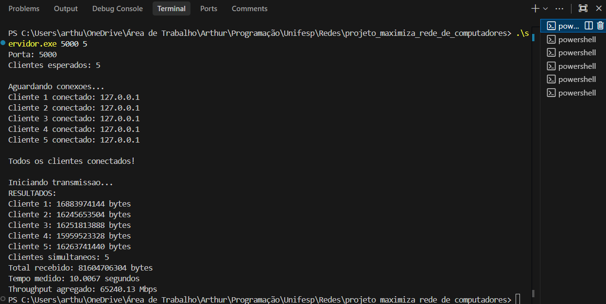
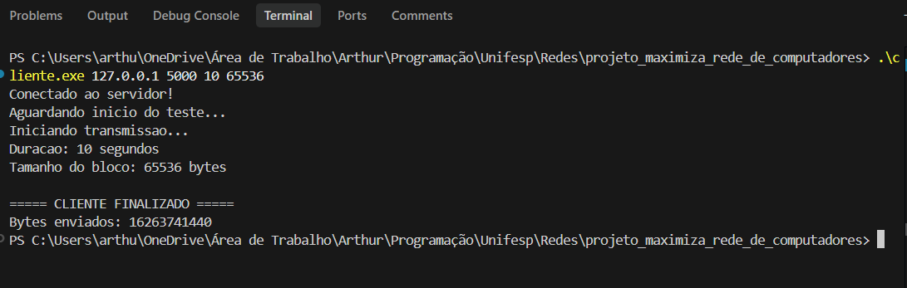

# Projeto: Maximização do Throughput em Rede de Computadores

Projeto da disciplina de **Redes de Computadores (UNIFESP)** para medir o **throughput agregado** de uma rede TCP quando vários clientes transmitem dados simultaneamente para um único servidor.

## Visão geral

O projeto é composto por dois programas desenvolvidos em C utilizando **Winsock2 (Windows)**: um servidor e múltiplos clientes.

### Servidor (`servidor.c`)

O servidor:

1. Escuta em uma porta TCP informada pelo usuário;
2. Aguarda a conexão de **todos** os clientes esperados antes de iniciar o teste;
3. Cria uma **thread por cliente** para receber os dados em paralelo;
4. Envia um sinal de início (`'G'`) a todos os clientes e inicia o cronômetro (`QueryPerformanceCounter`);
5. Contabiliza os bytes recebidos de cada cliente até que todos encerrem a conexão;
6. Exibe o total recebido, o tempo medido e o **throughput agregado em Mbps**.

### Cliente (`cliente.c`)

O cliente é responsável por estabelecer uma conexão TCP com o servidor e transmitir dados durante um período determinado.

Seu funcionamento ocorre nas seguintes etapas:

1. Recebe como parâmetros o endereço IP do servidor, a porta TCP, a duração do teste e o tamanho dos blocos de dados;
2. Inicializa a biblioteca Winsock2 e cria um socket TCP;
3. Configura o endereço IP e a porta do servidor;
4. Estabelece a conexão TCP com o servidor;
5. Aguarda o recebimento de um byte contendo o caractere `'G'`, enviado pelo servidor como sinal de início do teste;
6. Aloca um buffer de memória com o tamanho de bloco especificado, preenchido com o caractere `'A'`;
7. Inicia a medição do tempo com `QueryPerformanceCounter` e transmite blocos de dados continuamente até atingir a duração configurada;
8. Garante que cada bloco seja enviado completamente, contabilizando a quantidade total de bytes transmitidos;
9. Encerra o envio de dados utilizando `shutdown()` e libera os recursos utilizados.

O cliente utiliza `QueryPerformanceCounter` para controlar a duração da transmissão e contabiliza os bytes enviados, permitindo comparar o volume transmitido com os dados contabilizados pelo servidor.

## Protocolo de comunicação

A comunicação entre cliente e servidor segue o seguinte fluxo:

1. O servidor inicia e aguarda as conexões dos clientes;
2. Cada cliente estabelece uma conexão TCP com o servidor;
3. O servidor aguarda a conexão de todos os clientes esperados;
4. O servidor envia o sinal de início (`'G'`) para cada cliente;
5. Os clientes iniciam a transmissão contínua de dados;
6. Ao atingir a duração configurada, cada cliente encerra seu envio;
7. O servidor identifica o encerramento de cada transmissão e calcula o throughput agregado.

> O servidor considera a transmissão de um cliente finalizada quando `recv()` retorna `0` (conexão encerrada) ou ocorre um erro.

## Compilação

### MinGW (GCC)

**Servidor:**

```bash
gcc servidor.c -o servidor.exe -lws2_32
```

**Cliente:**

```bash
gcc cliente.c -o cliente.exe -lws2_32
```

### MSVC (Developer Command Prompt)

**Servidor:**

```bash
cl servidor.c
```

**Cliente:**

```bash
cl cliente.c
```

> No MSVC, a biblioteca `Ws2_32.lib` é vinculada automaticamente via `#pragma comment(lib, "Ws2_32.lib")`.

## Execução

### Servidor

```bash
.\servidor.exe <porta> <numero_clientes>
```

| Parâmetro | Descrição | Limites |
|---|---|---|
| `porta` | Porta TCP em que o servidor irá escutar | 1 – 65535 |
| `numero_clientes` | Quantidade de clientes simultâneos esperada | 1 – 10 |

Exemplo:

```bash
.\servidor.exe 5000 4
```

### Cliente

```bash
.\cliente.exe <IP> <porta> <duracao> <bloco_bytes>
```

| Parâmetro | Descrição | Limites |
|---|---|---|
| `IP` | Endereço IPv4 do servidor | Endereço IPv4 válido (ex: `127.0.0.1`) |
| `porta` | Porta TCP utilizada pelo servidor | 1 – 65535 |
| `duracao` | Tempo de transmissão em segundos | Maior ou igual a 1 |
| `bloco_bytes` | Tamanho de cada bloco de dados transmitido, em bytes | 1 – 1.048.576 |

Exemplo:

```bash
.\cliente.exe 127.0.0.1 5000 10 65536
```

Nesse exemplo, o cliente se conecta ao servidor no endereço local `127.0.0.1`, utilizando a porta `5000`, e transmite dados durante 10 segundos, em blocos de 65.536 bytes (64 KiB).

> **Atenção:** O número de clientes iniciados nos terminais deve corresponder exatamente ao número informado na execução do servidor para que o teste seja disparado.

## Cálculo do throughput

O servidor calcula o throughput agregado considerando a quantidade total de bytes recebidos de todos os clientes e o tempo total da medição:

```text
throughput (Mbps) = (total_bytes × 8) / (tempo_em_segundos × 1.000.000)
```

O tempo é medido desde o envio do sinal de início até o término de todas as threads de recepção.

## Configurações

### Servidor (`servidor.c`)

| Constante | Valor | Descrição |
|---|---|---|
| `MAX_CLIENTS` | `10` | Número máximo de clientes simultâneos |
| `BUFFER_SIZE` | `65536` | Tamanho do buffer de recepção (bytes) |

### Cliente (`cliente.c`)

| Constante | Valor | Descrição |
|---|---|---|
| `MAX_BUFFER_SIZE` | `1048576` | Tamanho máximo permitido para o buffer de transmissão (1 MiB) |

---

## Resultados dos Testes (1 a 5 Clientes)

Os testes foram realizados em ambiente local (interface de *loopback* `127.0.0.1`), com duração configurada de **10 segundos** e blocos de **65.536 bytes (64 KiB)** por cliente.

### Tabela Comparativa de Desempenho

| Clientes Simultâneos | Duração Medida (s) | Total Recebido (Bytes) | Throughput Agregado (Mbps) | Throughput Agregado (Gbps) |
|:---:|:---:|:---:|:---:|:---:|
| **1** | 10.0024 s | 25.818.955.776 | 20.650,31 Mbps | ~20,65 Gbps |
| **2** | 10.0020 s | 52.880.736.256 | 42.296,12 Mbps | ~42,30 Gbps |
| **3** | 10.0024 s | 52.320.665.600 | 41.846,54 Mbps | ~41,85 Gbps |
| **4** | 10.0031 s | 71.237.763.072 | 56.972,30 Mbps | ~56,97 Gbps |
| **5** | 10.0067 s | 81.604.706.304 | 65.240,13 Mbps | ~65,24 Gbps |

---

### Detalhamento por Teste

#### 1 Cliente
* **Dados por cliente:**
  * Cliente 1: 25.818.955.776 bytes
* **Total recebido:** 25.818.955.776 bytes (~25,82 GB)
* **Tempo:** 10.0024 s
* **Throughput:** **20.650,31 Mbps** (~20,65 Gbps)

<details>
<summary>Visualizar Captura de Tela (1 Cliente)</summary>



</details>

---

#### 2 Clientes
* **Dados por cliente:**
  * Cliente 1: 26.610.434.048 bytes
  * Cliente 2: 26.270.302.208 bytes
* **Total recebido:** 52.880.736.256 bytes (~52,88 GB)
* **Tempo:** 10.0020 s
* **Throughput:** **42.296,12 Mbps** (~42,30 Gbps)

<details>
<summary>Visualizar Captura de Tela (2 Clientes)</summary>



</details>

---

#### 3 Clientes
* **Dados por cliente:**
  * Cliente 1: 16.883.318.784 bytes
  * Cliente 2: 17.090.347.008 bytes
  * Cliente 3: 18.346.999.808 bytes
* **Total recebido:** 52.320.665.600 bytes (~52,32 GB)
* **Tempo:** 10.0024 s
* **Throughput:** **41.846,54 Mbps** (~41,85 Gbps)

<details>
<summary>Visualizar Captura de Tela (3 Clientes)</summary>



</details>

---

#### 4 Clientes
* **Dados por cliente:**
  * Cliente 1: 17.415.733.248 bytes
  * Cliente 2: 17.669.488.640 bytes
  * Cliente 3: 17.825.005.568 bytes
  * Cliente 4: 18.327.535.616 bytes
* **Total recebido:** 71.237.763.072 bytes (~71,24 GB)
* **Tempo:** 10.0031 s
* **Throughput:** **56.972,30 Mbps** (~56,97 Gbps)

<details>
<summary>Visualizar Captura de Tela (4 Clientes)</summary>



</details>

---

#### 5 Clientes
* **Dados por cliente:**
  * Cliente 1: 16.883.974.144 bytes
  * Cliente 2: 16.245.653.504 bytes
  * Cliente 3: 16.251.813.888 bytes
  * Cliente 4: 15.959.523.328 bytes
  * Cliente 5: 16.263.741.440 bytes
* **Total recebido:** 81.604.706.304 bytes (~81,60 GB)
* **Tempo:** 10.0067 s
* **Throughput:** **65.240,13 Mbps** (~65,24 Gbps)

<details>
<summary>Visualizar Captura de Tela (5 Clientes)</summary>



</details>

---

### Análise dos Resultados

1. **Escalabilidade com Múltiplas Threads:** O throughput cresceu significativamente conforme o número de clientes aumentou (de **~20,65 Gbps** com 1 cliente até atingir a marca de **~65,24 Gbps** com 5 clientes simultâneos).
2. **Paralelismo em Loopback:** Como os testes foram realizados localmente via loopback, a comunicação em paralelo permitiu aproveitar múltiplos núcleos da CPU através do modelo multithread do servidor, maximizando a transferência de memória e pilha TCP do sistema operacional.
3. **Equilíbrio de Carga:** Com múltiplos clientes (em especial nos testes com 3, 4 e 5 clientes), os volumes de bytes transferidos individualmente foram muito próximos entre si, demonstrando justa alocação de tempo e recursos pelo escalonador do SO e pela pilha de rede.

---

## Estrutura do repositório

```text
.
├── cliente.c       # Cliente TCP para transmissão contínua de dados
├── servidor.c      # Servidor TCP multithread de medição de throughput
├── Makefile        # Script de compilação automatizada
├── prints/         # Capturas de tela dos testes realizados (1 a 5 clientes)
├── README.md       # Documentação do projeto e resultados dos testes
└── .gitignore
```
