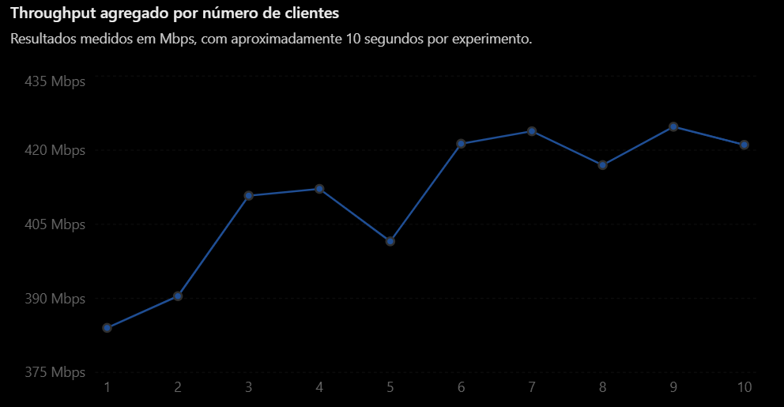

## Resultados dos Experimentos

Foram realizados testes com **1 a 10 clientes TCP simultâneos**, mantendo a duração de cada experimento em aproximadamente 10 segundos.

O objetivo foi avaliar o comportamento do throughput agregado conforme aumenta o número de conexões simultâneas.

### 1. Comparativo geral

| Clientes simultâneos | Total recebido (bytes) | Tempo (s) | Throughput agregado (Mbps) |
|:---:|---:|---:|---:|
| 1 | 482.541.568 | 10,0525 | 384,02 |
| 2 | 495.386.624 | 10,1502 | 390,44 |
| 3 | 521.863.168 | 10,1633 | 410,78 |
| 4 | 527.302.656 | 10,2350 | 412,16 |
| 5 | 516.030.464 | 10,2810 | 401,54 |
| 6 | 541.851.648 | 10,2888 | 421,31 |
| 7 | 548.012.032 | 10,3440 | 423,83 |
| 8 | 541.786.112 | 10,3945 | 416,98 |
| 9 | 552.861.696 | 10,4132 | **424,74** |
| 10 | 551.813.120 | 10,4837 | 421,08 |

### 2. Throughput agregado por número de clientes

Os resultados mostram o comportamento do throughput agregado durante os experimentos:

| Clientes | Throughput (Mbps) |
|:---:|---:|
| 1 | 384,02 |
| 2 | 390,44 |
| 3 | 410,78 |
| 4 | 412,16 |
| 5 | 401,54 |
| 6 | 421,31 |
| 7 | 423,83 |
| 8 | 416,98 |
| 9 | **424,74** |
| 10 | 421,08 |

### 3. Resultados individuais por cliente

Abaixo estão os bytes recebidos individualmente por cada cliente em cada experimento.

<strong>Experimento com 1 cliente</strong>

| Cliente | Bytes recebidos |
|:---:|---:|
| 1 | 482.541.568 |

<strong>Experimento com 2 clientes</strong>

| Cliente | Bytes recebidos |
|:---:|---:|
| 1 | 193.200.128 |
| 2 | 302.186.496 |

<strong>Experimento com 3 clientes</strong>

| Cliente | Bytes recebidos |
|:---:|---:|
| 1 | 259.719.168 |
| 2 | 91.619.328 |
| 3 | 170.524.672 |

<strong>Experimento com 4 clientes</strong>

| Cliente | Bytes recebidos |
|:---:|---:|
| 1 | 92.667.904 |
| 2 | 116.981.760 |
| 3 | 100.335.616 |
| 4 | 217.317.376 |

<strong>Experimento com 5 clientes</strong>

| Cliente | Bytes recebidos |
|:---:|---:|
| 1 | 112.001.024 |
| 2 | 105.185.280 |
| 3 | 97.320.960 |
| 4 | 101.974.016 |
| 5 | 99.549.184 |

<strong>Experimento com 6 clientes</strong>

| Cliente | Bytes recebidos |
|:---:|---:|
| 1 | 83.230.720 |
| 2 | 83.034.112 |
| 3 | 136.970.240 |
| 4 | 79.691.776 |
| 5 | 79.495.168 |
| 6 | 79.429.632 |

<strong>Experimento com 7 clientes</strong>

| Cliente | Bytes recebidos |
|:---:|---:|
| 1 | 86.441.984 |
| 2 | 76.611.584 |
| 3 | 58.261.504 |
| 4 | 82.903.040 |
| 5 | 73.007.104 |
| 6 | 86.573.056 |
| 7 | 84.213.760 |

<strong>Experimento com 8 clientes</strong>

| Cliente | Bytes recebidos |
|:---:|---:|
| 1 | 64.946.176 |
| 2 | 47.972.352 |
| 3 | 72.744.960 |
| 4 | 79.429.632 |
| 5 | 72.744.960 |
| 6 | 65.732.608 |
| 7 | 74.055.680 |
| 8 | 64.159.744 |

<strong>Experimento com 9 clientes</strong>

| Cliente | Bytes recebidos |
|:---:|---:|
| 1 | 61.145.088 |
| 2 | 47.710.208 |
| 3 | 67.436.544 |
| 4 | 37.879.808 |
| 5 | 62.062.592 |
| 6 | 76.152.832 |
| 7 | 106.168.320 |
| 8 | 47.644.672 |
| 9 | 46.661.632 |

<strong>Experimento com 10 clientes</strong>

| Cliente | Bytes recebidos |
|:---:|---:|
| 1 | 55.115.776 |
| 2 | 58.589.184 |
| 3 | 41.222.144 |
| 4 | 45.154.304 |
| 5 | 64.094.208 |
| 6 | 67.895.296 |
| 7 | 64.749.568 |
| 8 | 37.158.912 |
| 9 | 66.125.824 |
| 10 | 51.707.904 |

### 4. Análise dos resultados

Os experimentos demonstraram que o aumento do número de clientes simultâneos elevou o throughput agregado em relação ao teste com apenas um cliente.

O maior resultado foi obtido com 9 clientes simultâneos, alcançando 424,74 Mbps.

A partir de 6 clientes, os resultados permaneceram relativamente próximos, variando entre 416,98 Mbps e 424,74 Mbps nos testes com 6 a 10 clientes, indicando uma tendência de estabilização do throughput agregado.

É importante observar que o aumento do número de conexões não resultou em crescimento proporcional do throughput. Isso sugere que a capacidade de transmissão da rede começa a ser compartilhada entre os clientes, sendo influenciada pelos limites do ambiente de teste.

Observação: os resultados representam medições experimentais individuais. Para uma comparação mais precisa, recomenda-se repetir cada configuração e calcular a média dos resultados.